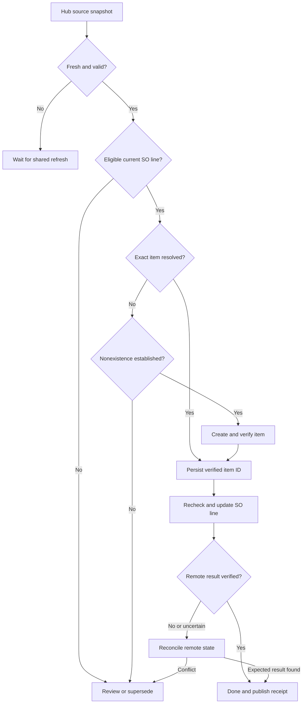

# ENTERNEWPART: current logic and Central Data Hub redesign

Design date: October 19, 2026. Status: PROPOSED; no production cutover.

## Decision

Make ENTERNEWPART a Central Data Hub consumer and an operational workflow within the Hub portfolio. Centralize reusable report reads, canonical schemas, freshness metadata and visibility. Retain one ENTERNEWPART owner for item creation, Sales Order changes, job state and notifications. Do not place Striven business writes inside the Hub refresh engine.

This follows the checked Hub README: bulk reads belong centrally; operational POST/PUT/PATCH/DELETE belong to the owning project; targeted reads are allowed for cache misses and immediate verification.

## Evidence and limits

- ENTERNEWPART: the 15 supplied files, backed up in consultpramodh/classicfireplace at commit cb3a602cc7ddbe2e9348383d22ea78d5d0c34c00. These are uploaded source, not a live pull.
- Queue repair preview: commit 5cdeac98ae4922898da7cd7ba233b036d73237b3. Fifteen offline assertions passed. It is not a production deployment or a complete redesign.
- Hub: checked consultpramodh/StrivenCentralDataHub at ref 650fd9e2f1569c40f2dc97c4cef7997db0d2352f: README.md, PATCH_SOURCE/00_Config.js, PATCH_SOURCE/10_Central_Hub.js, deployment workflow.
- Hub configuration already registers ENTERNEWPART, its spreadsheet and script ID. That is configuration evidence, not confirmation of installed triggers, access or current source.
- The checked Hub source contains manual canonical Items refresh plus Contacts, Locations and PO scope functions. DATA_SALES_ORDERS and DATA_SO_DETAILS appear in the configured dataset list; this does not establish complete populated datasets or ENP-compatible filters.
- The README's September Items test result is historical documentation, not a fresh live test. Current rows, freshness, permissions, triggers, quotas and deployment parity remain unverified.
- enp_guardedPipelineTick is absent from the uploaded files. Earlier reported live name-collision, 429 and historical queue counts are context, not independently rechecked live evidence for this design.

## 1. Current logic

### Two automation paths

| Stage | Legacy path | Consolidated path | Consequence |
|---|---|---|---|
| Schedule | enternewpart_pipeline_tick plus separate enternewpart_actionHub_tick; installers specify 10 minutes | enp_pipelineTick; installer specifies 10 minutes | Multiple possible schedulers; actual installed triggers unknown |
| Source reads | Approved/Quoted report sync; local Striven_Items | enp_syncAllReports refreshes Items, Approved and Quoted before queuing | Processing coupled to repeated report refresh |
| Eligibility | Approved auto; Quoted uses SendToActions gate | Placeholder ItemNumber ENTERNEWPART; Quoted accepts Y/YES/TRUE; excludes done/replaced rows | Gate semantics differ by implementation; live report filters need checking |
| Parsing | Multiple parser definitions and helpers | Labeled Item Number, Item Name, Price parser; explicit NewItem fields can override payload values | Different entry points may interpret the same input differently |
| Item resolution | Local index by item number, otherwise create | Local index or stored NewItemId, otherwise POST /v1/items | Cache absence treated as permission to create; duplicate SKU handling is not robust |
| Queue | ENP_CFG consumers with incompatible configuration paths | ENP.HUB headers; row-based source references and job keys containing source row number | Queue layout and refreshes can break identity |
| SO replacement | GET SO; LineId preference or item/quantity/description token fallback | GET SO; placeholder/new item ID plus quantity and SKU token matching | Substring matching can confuse similar SKUs; ambiguous matches stop |
| Completion | SO POST followed by DONE and source writeback | SO POST followed by DONE and source writeback | These runners do not require post-write read-back before DONE |
| Failures | FAILED plus next-run date, but runner accepts PENDING only | Retries validation failures until attempt limit | Stranded work or repeated permanent errors |
| Manual create | Separate direct-create functions | Separate manual item-creation module | Alternate paths can bypass queue safeguards |

Code anchors: 11-01_config_menu: enp_pipelineTick; 13-03_enternewpart_sync_and_actions: enp_syncAllReports, enp_syncReportToSheet_, enp_buildItemPayloadFromSheetRow_; 14-04_actionhub: queue, item-create, replacement and failure helpers; 01-action_hub: legacy runner; 09-enternewpart_pipeline: legacy intake. Duplicate public helpers and onOpen definitions exist across the uploads.

The consolidated source creates/resolves the item before fetching and validating the current SO line. Redesign reverses that dependency: establish an eligible current line before creating anything.

## 2. Ownership map

| Capability | Proposed owner | Reuse / change |
|---|---|---|
| Canonical Items master | Hub DATA_ITEMS | Reuse canonical aliases; add published snapshot identity/freshness contract |
| Approved and Quoted source reads | Hub ingestion | Reuse SO datasets only after matching fields, filters and line grain; otherwise register scoped ENP source datasets |
| Report pagination and validation | Hub ingestion | One controlled refresh per dataset; validate whole snapshot before publication |
| Eligibility, parsing and approvals | ENTERNEWPART | One deterministic rule set across auto and manual entry points |
| Job and command ledger | ENTERNEWPART | Replace row identity with durable job/line keys and versioned commands |
| Targeted SKU/SO reads | ENTERNEWPART adapter | Budgeted authoritative checks; no full-catalog fallback per job |
| Item creation and SO writes | ENTERNEWPART writer | One writer authority with persisted checkpoints and read-back |
| Newly verified item visibility | Hub ingestion via receipt | Publish verified receipt/overlay; canonical refresh remains authoritative publisher |
| Exceptions and completion | ENTERNEWPART; Hub reads summary | One deduplicated issue per job/reason/source version |
| Cross-project API admission | Shared coordinator, proposed | Persistent shared reservations and cooldown; not independent project-local counters |

A Hub ScriptLock does not coordinate another Apps Script project's writer. Define an actual shared admission endpoint/coordinator or conservatively partition budgets across known callers. Until shared admission exists, do not claim a globally enforced limit. Unmigrated callers must be inventoried; reserve headroom for them.

## 3. Target processing decisions

1. **Read a published source snapshot.** Require known schema version, scope/filter version, source timestamp, completeness and snapshot ID. Refuse partial/invalid snapshots. Keep last good data visible but mark its age and block decisions outside the agreed freshness policy.
2. **Discover eligible SO lines.** Require placeholder item identity and current approved status, or Quoted with an explicit grant. Report membership alone is not approval. Manual item-only requests use the same resolver but have no SO mutation stage.
3. **Assign durable identity.** Use tenant + internal SO ID + authoritative line ID. Retain originating report references for traceability, never source row number as identity. If the report omits line IDs, use a bounded SO GET to resolve exactly one line. Two identical lines without authoritative IDs go to review.
4. **Parse and validate once.** Preserve raw text. Record normalized SKU, requested name, line price and quantity separately. Define missing versus zero explicitly; reject malformed amounts. Preserve meaningful SKU punctuation. Explicit overrides create a new input version and must agree with the approved command.
5. **Validate the current SO before creating an item.** Re-read when processing a write. Confirm status, line ID, placeholder identity, quantity and expected description/input version. A changed or deleted line supersedes/blocks the command. Capture expected preimage.
6. **Resolve item identity.** Exact normalized SKU candidates from DATA_ITEMS plus verified recent receipts. Reject duplicate candidates, inactive/invalid items or conflicting vendor/manufacturer evidence. Name similarity is never identity. If necessary verify candidate details directly.
7. **Handle cache miss.** Use an exact authoritative lookup only after its actual API behavior and scope have been verified. If no suitable lookup exists, request one shared complete refresh and wait; if absence still cannot be established, review. Do not invent a search parameter or perform repeated full-catalog scans. A fresh filtered report still cannot prove absence outside its scope.
8. **Create only when safe.** Require established nonexistence, approved metadata, configured type/accounts/tax policy and a unique name. Do not silently set inventory cost to zero because SO price was supplied. A name collision for a different SKU requires a reviewed naming rule, such as Name (SKU), never substitution. Persist create intent and a SKU-scoped lease before POST. After success, GET the returned ID and verify SKU and expected identity before recording ITEM_VERIFIED.
9. **Patch only the intended SO line.** Preserve unrelated lines, quantities, discounts, taxes, notes and totals except explicitly approved changes. Prefer a verified line-level update API if available. The existing full-SO POST must not be reused until its field preservation and concurrency behavior are verified. Re-read immediately before write; if no conditional-write/version mechanism exists, document the residual race with other users/writers. Local locks alone do not eliminate it.
10. **Read back before DONE.** Confirm line ID, new item ID, intended description/price, preserved quantity and unrelated-line preservation. Record observed values and verification time. A 2xx response alone is not completion.
11. **Recover uncertain writes.** Timeout/5xx after a mutation means RECONCILE_REQUIRED, not permission to repeat POST. Query the affected item/SO and compare expected postimage. Reuse verified item IDs. Retry a mutation only after proving the previous attempt did not commit or using a verified server idempotency mechanism.
12. **Publish outcome.** Persist verified receipt and job result; update operator view by stable key. Queue any Hub receipt publication and notification separately so their failure cannot cause a second item creation or SO update.

The prior bounded queue preview retries 5xx generically. That is insufficient for uncertain mutation outcomes; replace it with step-aware recovery before production redesign cutover.

## 4. Proposed data contracts

Do not change existing DATA_ITEMS columns in place. Keep its 15 canonical fields and mandatory aliases. Add metadata through a versioned companion snapshot contract.

| Contract | Required fields / rules |
|---|---|
| Published dataset metadata | DatasetKey, SchemaVersion, SnapshotId, ScopeVersion, StartedAt, CompletedAt, LastSuccessAt, RowCount, Complete, ValidationStatus, SourceKeys; publisher changes committed pointer only after complete validation |
| ENP source line | TenantKey, SOId, SONumber, SOLineId, SOStatus, PlaceholderItemId, RawDescription, Quantity, LinePrice, Currency if source supplies it, RepId, SourceUpdatedAt if supplied, SnapshotId; fields absent from sources remain unknown |
| Quoted authorization | SOId + SOLineId + InputVersion, Allowed, ApprovedBy, ApprovedAt, RevokedAt; never attach permission to a moving row |
| ENP job | JobId, LineKey, InputVersion, SnapshotId, State, Stage, ReasonCode, ItemId, AttemptsByStage, NextRunAt, LeaseOwner, LeaseUntil, CreatedAt, UpdatedAt, VerifiedAt |
| Write command / receipt | CommandId, JobId, Operation, PayloadHash, ExpectedPreimageHash, ExpectedPostimageHash, StartedAt, ResponseStatus, ReturnedId, Outcome, VerificationEvidence; persist intent before network mutation |
| Catalog resolution evidence | SKU, CandidateIds, ScopeVersion, SnapshotId, CheckedAt, LookupMethod, IdentityDecision; duplicate keys remain explicit |
| Operator exception | JobId, ReasonCode, InputVersion, Owner, FirstSeenAt, LastSeenAt, Resolution; notifications deduplicate by these keys |

A snapshot contract needs real publication semantics: write staging, validate, publish committed pointer/version, let readers pin that version. Clear-and-rewrite plus a timestamp does not guarantee readers see a consistent snapshot.

## 5. States and safe recovery

| State | Meaning / next step |
|---|---|
| DISCOVERED | Stable line found; validate input and authorization |
| WAITING_DATA | Snapshot stale, incomplete or missing; shared refresh request, no creation |
| READY | Current input and line validated; plan item resolution |
| ITEM_CREATE_INTENT | Durable create command recorded; ambiguity after call requires reconciliation |
| ITEM_VERIFIED | Verified existing/new item ID persisted; never recreate simply because SO update failed |
| SO_WRITE_INTENT | Durable SO command/preimage recorded |
| VERIFYING | Query remote outcome; no repeat mutation while unresolved |
| RETRY_WAIT | Recoverable read/rate-limit failure; bounded backoff and shared cooldown |
| REVIEW | Invalid/ambiguous business input or metadata; only corrected input/explicit resolution reopens |
| RECONCILE_REQUIRED | Prior write outcome unknown; inspect remote state before any retry |
| SUPERSEDED | Source version/line or authorization changed; do not run old command |
| DONE | Remote postimage checked and durable completion saved |

Lease expiry does not reset a mutation intent to READY. Claims, rechecks and final transitions must be persisted under the single writer's coordination. SKU locks are shared across jobs, SO locks serialize changes to different lines on the same order.

## 6. API policy and schedules

Proposed, not enabled: refresh Items independently of ENP ticks; short batch ticks consume snapshots. Choose cadence from measured arrival-to-completion needs and shared call budget, not from the old ten-minute loop. First rollout runs manually in shadow.

For a job reusing an item, the proposed baseline is one current SO GET, one verified SO mutation and one read-back GET, plus candidate verification when needed. This is an estimate of the designed path, not a measured total; late concurrency rechecks, pagination, authentication, recovery and optional checks add calls. Several lines on one SO may share one fetched SO and one checked update only if per-line command accounting remains correct.

For a new item, add authoritative absence checks, one create and one verification GET. The absence check cost is unknown until endpoint support and report scope are established. Never promise zero lookup calls on a cache miss.

Record admission reservations and actual usage by endpoint, dataset, job and operation. Honor observed Retry-After where supplied, apply bounded backoff, and stop the batch on shared cooldown. Determine the actual rate-limit scope and other callers before setting a numeric production budget. API_USAGE_LOG records usage; it does not by itself enforce a budget.

## 7. Migration and release gates

1. **Recover actual source:** use the Hub-registered script ID to pull live ENTERNEWPART; verify target, enp_guardedPipelineTick, dependencies, triggers and Script Property names. Inspect live Hub too. Configuration is a discovery lead, not proof of deployment.
2. **Contract audit:** inspect actual Hub DATA_ITEMS and ENP report payloads. Verify pagination, duplicates, active/inactive coverage, source filters, required fields and line IDs. Confirm freshness needs. Do not declare SALES_ORDERS/SO_DETAILS ready from their tab names.
3. **Shadow adapter:** read Hub Items and new source contracts with all business writes disabled. Compare local versus Hub decisions on the same snapshot/window. Reconcile every eligible/missing/ambiguous line and explain differences; row counts alone are insufficient.
4. **Single writer:** consolidate auto/manual entry points, checkpoint ledger, source version checks, shared API admission, uncertain-write recovery and post-write verification. Historical ActionHub jobs stay held for stable-key reconciliation.
5. **Controlled cases:** test exact SKU reuse, duplicate name/different SKU, missing/inactive/duplicate SKU, missing/zero price, stale snapshot, similar SKU tokens, identical SO lines, Quoted consent/revocation, concurrent jobs/SO edits, 429, timeout-after-create, timeout-after-SO-write, receipt/notification failure and trigger overlap. Use mocks for failure injection; no blind production replay.
6. **Canary:** resolve one reviewed case, verify the exact SO line and all preserved fields. SO 586037 is a candidate only after inspecting its then-current state and product identity.
7. **Cutover:** verified PRE backup, drift check, minimal same-project patch, POST source comparison, current Apps Script PASS, GitHub synchronization. Disable legacy triggers only after new ownership is verified. Enable a small bounded batch and monitor reasons/calls/latency.
8. **Rollback:** restore verified PRE source/trigger ownership, retain the new command ledger and receipts. Reconcile any in-flight mutations first. A code rollback cannot undo already-created items or safely authorize replay.

No live migration or workflow dispatch is authorized by this design document alone. The user's task is mapping/redesign; this deliverable does not change production.

## Next implementation unit

Build the read-only Hub consumer adapter and snapshot/eligibility comparison first. It resolves the most important evidence gap without creating items or changing Sales Orders. Do not start by moving all 15 files into the Hub.

## Target decision map

Diagram scope: SO-linked processing. Item-only manual requests finish after verified item receipt. A failed reconciliation remains unresolved; it does not automatically repeat a mutation.

## 8. Mandatory enrichment before new-item creation

Added October 19, 2026 from the user's expanded field requirements. Status: design requirement, not implemented.

Insert RESEARCH_PENDING -> ENRICHING -> VALIDATING_METADATA -> READY_TO_CREATE after current-line validation and authoritative item nonexistence resolution. Existing items follow reuse verification; enrichment must not overwrite their catalog metadata silently.

Completeness means every named field has a disposition: VERIFIED, APPROVED_INTERNAL_RULE, NOT_APPLICABLE with reason, DEFERRED_TO_RECEIVING where appropriate, or UNRESOLVED. Required UNRESOLVED fields block creation. N/A/deferred values belong in the staging metadata, not literal text inserted into numeric, ID or Boolean API fields. Ignore the user's blank spacer columns. No arbitrary zero, true, invented UPC or serial number.

| User column | Governing source and proposed rule |
|---|---|
| Item Number | Preserve approved internal SKU; cross-reference exact manufacturer/distributor SKU. Never replace it solely from a similar online result. |
| Item Name | Official exact-product name; approved unique naming convention if collision; distinguish variants. |
| Price | Approved CAD catalog selling-price rule/current Canadian price list. Keep requested SO line price separately; a public competitor price is evidence for review, not authorization to change either price. |
| Cost | Current authenticated dealer price list, supplier quote or approved purchasing terms for the actual supplier, quantity and currency. Public retail price is never a substitute. Approved cost policy required; unknown does not become zero. |
| Item Category | Map verified product facts into existing approved Striven category IDs; missing/ambiguous category blocks rather than inventing a taxonomy. |
| Description | Factual summary of verified specifications and exact compatibility; no unsupported claims or wholesale copying of marketing text. |
| Preferred Vendor | Internal approved purchasing relationship and valid vendor ID. Manufacturer and selling supplier may differ. Manufacturer-direct sourcing must be established internally. |
| Manufacturer | Verified brand/manufacturer entity and approved Striven mapping; distinguish brand owner from distributor. |
| Manufacturer Part# | Exact official manufacturer part number including meaningful suffixes; separate it from internal SKU and distributor code. |
| Serial Number | First establish what this column means in the live sheet/API: unit serial, serial-tracking flag, or a business custom field. Actual unit serials come from the physical unit, receiving documents or authenticated asset records, not generic web research. Unit serial capture may be deferred to receiving; do not create one catalog SKU per serial. |
| Location Name | Approved internal inventory/default-location mapping and valid ID. Do not infer stock location from a product page, vendor address or requester. Do not populate quantities/stock by assigning a default location. |
| Taxable | Approved accounting/tax configuration for the actual item type; never infer from a vendor website or silently hardcode true. Unknown mapping requires accounting review. |
| Item Type | Approved Striven item-type ID based on inventory/noninventory/service treatment; block missing/ambiguous type. |
| UPC | Exact product variant and packaging level from official manufacturer/authorized distributor data, corroborated with GS1 where useful. Preserve leading zeros as text, validate length/check digit and identity. A valid checksum alone does not prove product ownership. Keep EAN/GTIN-14 separate unless a verified conversion/mapping is approved. |
| MAP Price | Current authorized Canadian MAP policy for exact SKU and effective dates, currency and channel. Record explicitly verified no-MAP applicability separately from unknown; a competitor discount is not MAP. |

Research priority: existing verified Hub enrichment -> current internal approved supplier documents/terms -> official manufacturer product page, manual or parts catalog -> authorized distributor/dealer source -> secondary retailer evidence for corroboration only. Internal sources govern internal fields; official catalog evidence governs product facts. Search snippets only locate documents; fetch/read the actual page or file before accepting a field. Record disagreements instead of majority voting.

Product matching must establish exact SKU/MPN and manufacturer, region, fuel/voltage/size/finish, revision and pack quantity when material. No generic-name matches such as THERMOSTAT. Do not assume G190-0004-SER is Napoleon, Ortal or another manufacturer until primary evidence establishes identity. Brand and SKU alone may be insufficient for compatibility.

For each field retain value, disposition, source URL/document ID and version/page, retrieved time, effective dates, currency, pack/UOM, extraction method, reviewer/rule version and conflict notes. Retain original currency/value and approved FX source/date/conversion separately if conversion is authorized; conversion of a US MSRP/MAP does not establish Canadian MSRP/MAP.

Cache research by exact product identity and source version; apply separate expiry rules for specifications, cost, retail price and MAP. Recheck time-sensitive commercial data before writing. Bound search work and place unresolved fields in one consolidated review case rather than repeated searches each tick. Never send customer names, SO private details or credentials to a public search engine; product identifiers are sufficient.

Hub integration: propose versioned PRODUCT_ENRICHMENT, ITEM_FIELD_EVIDENCE and approved supplier/category/location/type mapping contracts as companion datasets. Do not silently expand the existing 15-field DATA_ITEMS contract: Manufacturer Part# and Serial Number are not canonical fields in the inspected Items schema. Confirm all API field names, reference IDs, writable versus derived fields, custom-field IDs and tracking semantics before implementing payloads. Extend the source adapter and payload builder together; a filled sheet alone does not establish that Striven received those columns.

Write gate: exact identity + authoritative absence + validated current source line/authorization + required metadata dispositions + supported payload mapping + budget reservation. Persist evidence and command before POST, verify persisted supported fields by read-back, then publish receipt. If an applicable API cannot write a field required by policy, use REVIEW or an approved separate update step; never mark the item complete based on the sheet.

Additional acceptance cases: wrong SKU suffix, wrong fuel/voltage/pack, US versus Canadian pricing, stale dealer cost/MAP, unknown cost, missing UPC versus verified no UPC, checksum-valid wrong product, brand/distributor conflict, ambiguous category, missing vendor/location IDs, serial-versus-tracking confusion, source conflict, blocked dealer access, prompt injection in source pages, search outage, metadata-field API rejection and failed field read-back.

Primary identity reference checked: GS1, “How does serialisation differ from unique identification in the GS1 System?” https://support.gs1.org/support/solutions/articles/43000734238-how-does-serialisation-differ-from-unique-identification-in-the-gs1-system- . It distinguishes base product identity from an individual instance's serial number. The actual meaning of the user's Serial Number column remains unverified.

## 9. Supplied reference rules — supersedes Serial Number uncertainty above

The user supplied Pasted markdown(4).md and Pasted markdown (2).md as governing internal reference inputs. Both were read locally in full with blank/separator rows excluded from inspection.

- Supplier reference: 47 populated rules, including 45 populated discount percentages and two missing discounts. Preserve all original column labels and values. Do not publish the commercial discount table into a public GitHub repository; load it from an access-controlled configuration source at runtime.
- Category reference: 32 populated category-to-serial-tracking rules. Serial Numbers YES/NO means the desired serial-tracking policy; it is not a unit serial identifier. Stage it as SerialTrackingRequired and verify the actual Striven writable field/custom-field mapping before sending. Actual unit serial capture remains a separate receiving/asset operation.
- The reference's Manufacturer column frequently identifies a supplier/distributor and its Preferred Vendor column a brand or product family. Do not swap columns or reinterpret blank cells automatically. Retain SourceVendorName, SourceManufacturer, SourcePreferredVendor and DiscountPercent; establish explicit target manufacturer/vendor IDs and family selectors through current Striven records and approved semantics.
- Category matching must select one exact approved category after product verification; apply its supplied tracking Boolean directly. Unknown/unmapped categories block creation. Do not infer YES for every expensive item or NO for every equipment item.
- Discounts must match the most specific supplier/product-family rule. Generic supplier matching cannot override a family-specific rule. Missing discounts remain unknown, never zero.
- Proposed cost formula is eligible base price times (1 - discount rate), rounded under an approved money policy. The table does not state eligible base price, currency, effective dates, exclusions, freight/tax treatment or whether sequential discounts apply. These must be supplied/verified before automatic costing. Do not apply the discount to arbitrary web prices, MAP, or the customer SO line price. Direct supplier cost evidence can supersede a derived cost under a recorded precedence rule.
- Online evidence verifies exact product identity, product facts and current applicable Canadian price source; internal references govern purchasing mappings and tracking policies. Cache both evidence versions with the draft.
- Add regression cases for supplier-family precedence, missing discounts, blank source brand fields, ambiguous vendor/manufacturer mapping, unmapped category, each tracking flag, unknown price basis and conflicting direct quoted cost.
- The named input tables are design references only; neither live configuration nor item payloads have been changed.
